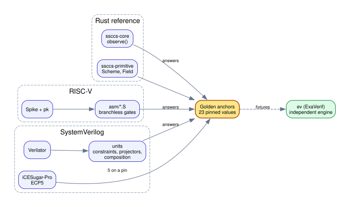
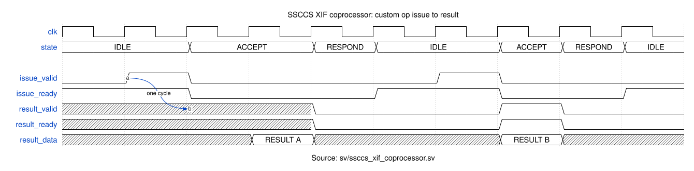
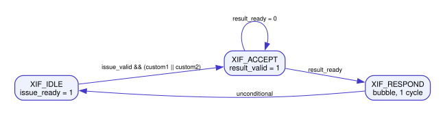

```{python}
#| include: false
#| context: local
title_meta_items = {
    "html": [
        {"title": "Code", "link": "https://github.com/ssccsorg/ssccs/tree/main/poc", "content": "GitHub", "icon": "bi bi-github"},
        {"title": "Guide", "link": "https://github.com/ssccsorg/ssccs/blob/main/poc/README.md", "content": "PoC README", "icon": "bi bi-file-text"},
        {"title": "Verification", "link": "https://docs.ssccs.org/projects/ev/", "content": "ExaVerif", "icon": "bi bi-check2-circle"},
        {"title": "Specification", "link": "https://ssccs.org/wp", "content": "Whitepaper", "icon": "bi bi-journal-text"},
    ],
}
```



## The pure plane in running code

SSCCS defines computation as the observation of a fixed structure under changing conditions. The proof of concept is the smallest complete materialization of that definition: a coordinate space, a set of constraints, a projector, and an observation function, implemented on three substrates and checked against one shared set of anchors.

It is the pure plane. The projects materialize the same primitives on the practical plane, and the proof of concept carries no project-specific knowledge. What it establishes is that the primitives are substrate-independent and that a convention can be pinned across languages and silicon.

The proof of concept covers the observation pipeline and the instruction-word interface. It is not a processor core, and it does not claim a full ISA implementation. The hardware contribution is the constraint and projector units, the XIF coprocessor that exposes them, and the carrier images that answer the anchors.



## The three substrates

Three implementations answer the same anchors. A Rust reference carries the ontology and the composition algebra. A branchless RISC-V assembly implementation runs the observation pipeline under Spike. A SystemVerilog implementation runs the units and the coprocessor under Verilator, and the same SystemVerilog builds for an iCESugar-Pro ECP5 board.

| Substrate | Scope | Verification |
|:---|:---|:---|
| Rust | `standard/` workspace: ontology, composition algebra, emitters | `cargo test --workspace`, golden anchors |
| RISC-V assembly | `baremetal_riscv/asm/`: branchless gates and observation | Spike with the proxy kernel |
| SystemVerilog | `baremetal_riscv/sv/`: units, coprocessor, testbenches | Verilator, Yosys |
| Carrier | `baremetal_riscv/boards/icesugar_pro/`: ECP5 images | anchors answered on the die |

An anchor is how a convention survives three languages. The `GOLDEN_*` block in the assembly is the single source, the SystemVerilog constants must match it, and the check fails when the two disagree. A convention restated in each substrate drifts at one of them; the anchor turns that drift into a failing check.

The carrier adds another kind of evidence. The board holds a constraint table of kinds and bounds, the modules the host emitted, and a design with no table of points. The table design is built twice, once with two expectations exchanged as a negative control. The die answers the table and the exchanged version differently, which is the case a checksum alone cannot see.

## A RISC-V interface for observation

The XIF coprocessor exposes the model as a RISC-V custom instruction. The core issues an operation, the coprocessor decodes the opcode and the sub-operation, evaluates a constraint or a projector, and returns a 64-bit result. The port follows the OpenHW CORE-V XIF issue and result handshake.



The encoding is defined in `baremetal_riscv/sv/_xif_constants.svh`, and the coprocessor decodes it in `baremetal_riscv/sv/ssccs_xif_coprocessor.sv`.

The units are combinational. The state machine holds in `XIF_ACCEPT` while the consumer is not ready and returns through `XIF_RESPOND`. The timing below reads from that module, and the formal property states that `result_valid` follows the issue handshake by one cycle.



The sub-operation is a field of the instruction, so the operands carry data and nothing else. A selector packed into an operand would quantize every bound by the selector's width; the encoding keeps the bound a full 64-bit value.



## Units as schematics

Each unit is small enough to read as a schematic. The images below are rendered from the SystemVerilog units rather than drawn by hand, so the structure they show is the structure the simulator elaborates.

::: {layout-ncol=3}


:::

`ck_range` is a signed range check, which matters because a coordinate is an `i64` and an unsigned compare would place every negative coordinate above every positive one. `proj_sum2d` is the projector that reduces a two-axis coordinate to its sum. `compose_product_2d` is the join of two constraint results, the composition that turns two one-dimensional constraints into a two-dimensional space.

## Verification evidence

The proof of concept rests on a set of checks that run in public.

- The golden anchors pin the assembly constants, the SystemVerilog constants, and the Rust reference, so the conventions the substrates share are checked rather than assumed.
- `ev` (ExaVerif) is an independent channel. It reproduces the anchors from its own classification engine and fixtures, so the agreement is between implementations rather than within one.
- The board answers the table design and the exchanged-expectations design, which keeps the negative control on the die.
- CI runs the workspace checks, the assembly syntax gate, the Verilator testbenches, and the container with Spike and the RISC-V toolchain. The visual assets on this page are rendered from the units by `poc/visuals/gen.sh`, so the schematic and the unit it describes are derived from one source.

## Run it

```bash
git clone https://github.com/ssccsorg/ssccs.git
cd ssccs/poc/standard
cargo build --release --workspace
cargo test --workspace
```

The hardware integration builds from the crate root:

```bash
cd ../baremetal_riscv
cargo build --release
make -C sv check
```

The full validation runs the workspace checks, the assembly syntax gate, the SystemVerilog checks, and the golden anchors. The CI container adds Spike, riscv-pk, and the RISC-V cross toolchain for the assembly channel.

```bash
cd ..
./run.sh --validation
```

## Where it leads

- [Whitepaper](/whitepaper/): the formal model and the technical specification.
- [Projects](/projects/): the practical plane built on the same substrate.
- [ExaVerif](/projects/ev/): exhaustive classification of a declared design space.
- [Direction](/direction/): the ecosystem orientation and the shared substrate.


