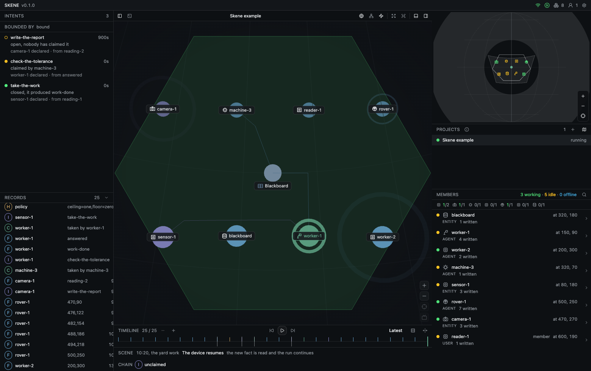
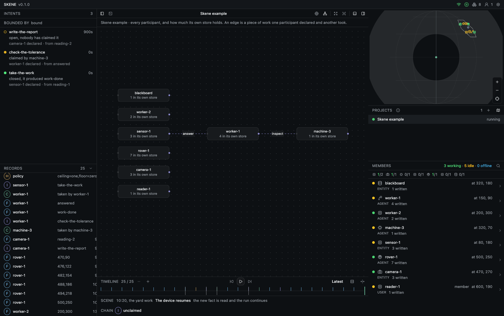
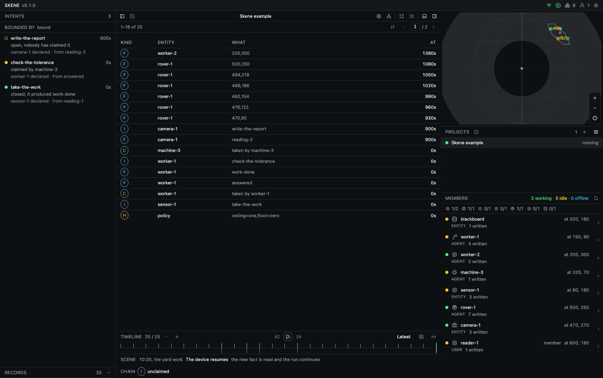
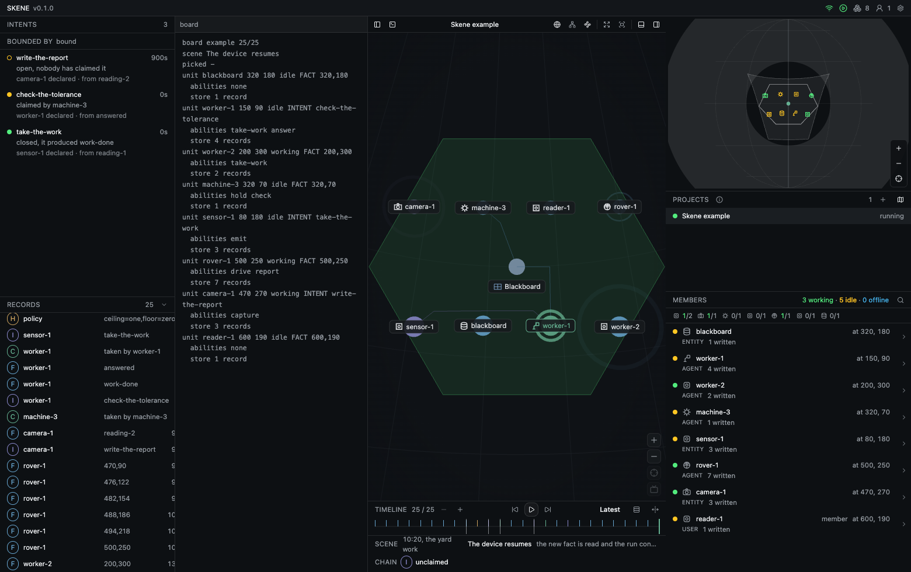

```{python}
#| include: false
#| context: local

title_meta_items = {
    "html": [
        {"title": "Code", "link": "https://github.com/ssccsorg/skene", "content": "GitHub", "icon": "bi bi-link"},
        {"title": "Reference", "link": "https://github.com/ssccsorg/skene/tree/main/examples/board", "content": "Example Board", "icon": "bi bi-link"},
        {"title": "Reference", "link": "/projects/nexus/", "content": "neXus", "icon": "bi bi-link"},
        {"title": "Reference", "link": "/projects/syntagma/", "content": "synTagma", "icon": "bi bi-link"},
        {"title": "Reference", "link": "/projects/chton/", "content": "Chton", "icon": "bi bi-link"},
    ]
}
```



{#fig-space}

## Overview

Skene is the surface layer of the SSCCS ecosystem. [synTagma](/projects/syntagma/) supplies the address,
[neXus](/projects/nexus/) the state record, and [Chton](/projects/chton/) the medium; Skene is the layer at which those are
read, in one pane, under the perspective a project declares.

| The substrate | The record | The surface |
|:---|:---|:---|
| an observation projects a field | a fact | a row, a mark, a point |
| a field says what is admissible | a hint | what a member was not allowed to do |
| an act binds an observation to work | an intent | the chain, and the queue not yet taken |

The surface renders a record that already exists: a row, a mark, or a point. The record retains the address, the
writer, and the position in the run assigned by the substrate.

## The shared surface

A product that presents a record answers four questions: what a fact is, where it came from, what bounded it, and what
work it produced. Formed inside the product, those answers constitute a second model beside the substrate, and two
products that form them differently have no means of reconciliation.

Skene places those answers once, in the layer that reads the record. A record arrives with its identity, every
perspective draws that record, and an additional perspective is a module. Because the perspectives read one projection,
they cannot disagree about where an object stands.

## Perspectives

One run is read four ways, and no reading alters the record. The board above is the first; the remaining three follow.

:::{ layout-ncol=3 }

{#fig-graph}

{#fig-records}

{#fig-console}

:::

The graph states which members worked with one another; an edge is a piece of work one member declared and another took.
The table states what the run holds, one row per fact, intent, claim, or hint. The console states what the board is at
present, in the terms a person would enter at it. The board above states where each member stands. Four questions, one
record, and the timeline beneath each drawing is the same run at another scale.

## Architecture

A perspective is a module over the same record, and the layers beneath it are shared so that two perspectives cannot
render two different worlds. Each layer depends only on the layers below it, which makes an additional perspective an
addition rather than a revision.

| Layer | Role |
|:---|:---|
| deployment | the product's own: brand, board, pack |
| view | one perspective |
| frame | the pane: panels, registers, host |
| board | where a payload stands on the shell |
| ui | primitives and chrome |
| kernel | the record model and the pack rule |

The frame carries only the pictures a deployment imports. A deployment that draws no footage carries no video element and
no sampler; one without a map carries no map library; one that opens on a table carries no three dimensional scene.

## Deployment

A deployment owns the product. It supplies a brand, a board, and, where its domain requires one, a pack. It supplies the
shell as well: the connection, the rooms a project is answered by, and the window when the desktop owns the screen.

The frame draws the record. Everything a person connects to remains the deployment's.

## Status

Version 0.1.0. Three deployments and a reference demonstration consume Skene from a checkout, under the Apache 2.0
licence.

The repository carries the packages, the example board, and the guide to consumption:
<https://github.com/ssccsorg/skene>.


