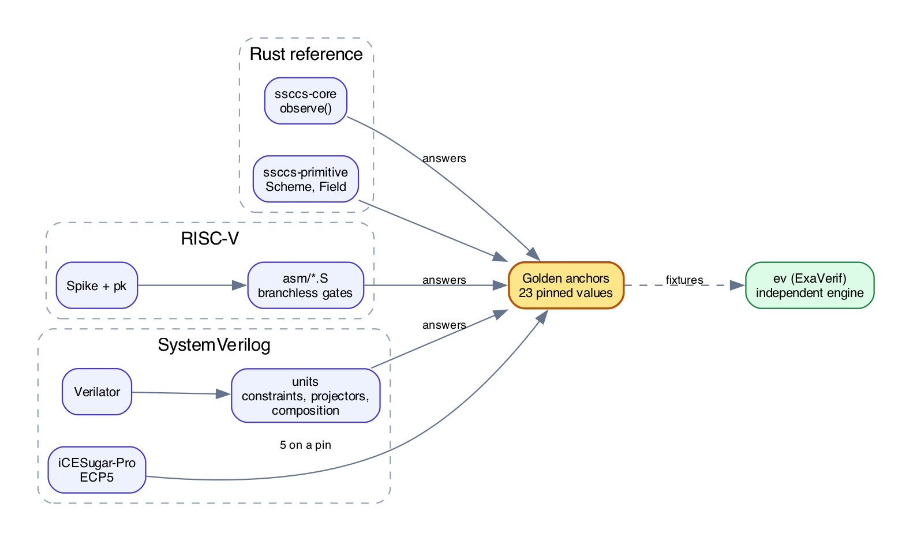
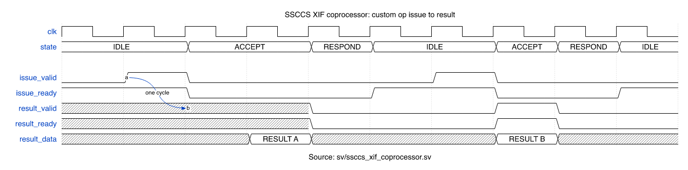
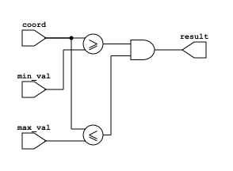

# SSCCS Proof of Concept

This directory contains proof-of-concept implementations of the Scheme–Segment Composition Computing System (SSCCS). SSCCS redefines computation as observation of structured potential rather than sequential state mutation. The abstract primitives are proven in parallel across three substrates: Rust (host simulation), RISC-V assembly (Spike), and SystemVerilog (Verilator), with golden anchors pinning all three and the independent `ev` (ExaVerif) verification CLI reproducing them from fixtures generated out of the same anchors.

The same SystemVerilog also runs on an iCESugar-Pro, and part of it is written by the host rather than by hand. A constraint program becomes an observation module whose body instantiates the units under `sv/constraints/` with its bounds baked in, and a Scheme becomes an address decoder derived from the Scheme's own segments; a Scheme that is not a product of equally spaced axes is refused rather than turned into a table. The carrier holds a constraint table of kinds and bounds, the modules the host emitted, and a design with no table of points. `baremetal_riscv/generated/` holds what the emitter writes, and nothing there is committed.

## What is here

| Path | What it is |
|---|---|
| `standard/` | Rust workspace: the ontology, the composition algebra, and the emitters |
| `baremetal_riscv/` | RISC-V and SystemVerilog integration: assembly, units, testbenches, board images |
| `benches/` | Criterion kernels comparing the SSCCS formulation against a Rust baseline |
| `visuals/` | SVG and PNG assets rendered from the units by `gen.sh` |
| `docs/` | The POC's development record: what a part does, and what it does not |
| `_llms/` | Per-crate reference generated by `doc.py` |
| `Dockerfile`, `run.sh`, `doc.py` | CI image, full validation, documentation generator |

## Visual assets

The hardware units render to SVG and PNG without a GUI. `visuals/gen.sh` reads the SystemVerilog units through Yosys and NetlistSVG, and renders the timing and FSM sources into images.







See [`visuals/README.md`](visuals/README.md) for the sources, requirements, and the limits of each image.

## Sub-Projects

### standard/: Host CPU Simulation

Rust workspace targeting x86_64 / aarch64. Implements the complete SSCCS ontology.

| Layer | Crate | Description |
|-------|-------|-------------|
| Primitives | `ssccs-core` | Segment, Coordinates, Constraint, Field, TransitionMatrix, Projector trait, observe() |
| Scheme | `ssccs-primitive` | Scheme, SchemeBuilder, SchemeTrait, Axis, StructuralRelation, MemoryLayout, ObservationRules |
| Scheme | `ssccs-schemes` | Grid2DTemplate, IntegerLineTemplate, GraphTemplate, Tensor3DTemplate, CompositeScheme, TransformedScheme, BooleanSpace, IntegerSpace |
| Utilities | `ssccs-examples` | IntegerProjector, ArithmeticProjector, ParityProjector, CoordinateSumProjector, CompilerPipeline, .ss parser, assembly data emitter, branchless constraint gate emitter |
| Experiments | `ssccs-concepts` | The constitutional concepts and one experiment, one binary each; each is compiled, run and gated on its own |
| Research | `ssccs-field-synthesis` | Field composition algebra, and composite versions that notice a constituent update |
| Research | `ssccs-hardware-mapping` | Composition-to-primitive mapping, and the SystemVerilog emitters for a constraint program and a Scheme's address decode |

Build commands run from `standard/`:

```bash
cd standard
cargo build --release --workspace
cargo test --workspace
cargo clippy --workspace -- -D warnings
cargo fmt --check --workspace
```

### baremetal_riscv/: RISC-V Hardware Integration

Standalone crate. Depends on `ssccs-core` and `ssccs-primitive` via path dependencies.

| Feature | Detail |
|---------|--------|
| Target triple | `riscv32imac-unknown-none-elf` (intent; the host fallback is the default path) |
| Panic strategy | abort |
| Dependencies | riscv, riscv-rt, panic-halt |
| Key APIs | `observe_emulate()`, `collapse_emulate()`, `encode_custom_rtype()`, `decode_custom()`, `CoreVXifProfile::issue_observation()` |
| Hardware profile | CoreVXifProfile for OpenHW CORE-V XIF |
| Substrates | Rust fallback (host), RV64 assembly under Spike (`simulation/`), SystemVerilog (`sv/`), SystemVerilog on an ECP5 (`boards/icesugar_pro/`) |

The same constraint pipeline is independently implemented across three substrates and pinned by a shared set of golden anchors: RISC-V assembly (`asm/*.S`), SystemVerilog (`sv/`), and the Rust fallback. `sv/check_golden_anchors.py` keeps the assembly and SV constants in sync, so any change to one forces the others to agree. An independent channel, the `ev` (ExaVerif) CLI, reproduces the anchors through its own constraint engine. `boards/icesugar_pro/` builds the same SystemVerilog for an ECP5 and reads the scenario's anchors off a pin. The carrier holds a constraint table of kinds and bounds, the modules the host emitted, and a design with no table of points that sweeps a decoded space and compares the admission count with the host's. The table design is built twice, once with two expectations exchanged as the negative control. The table design also answers an inquiry the scenario never uses, including negative bounds, so the die's own answer depends on the order the space uses. See `baremetal_riscv/README.md` for the full API reference and target reality.

An anchor is how a convention survives three languages. The `GOLDEN_*` block in the assembly is
the single source, `sv/_golden_anchors.svh` must match it, and `check_golden_anchors.py` fails
when the two disagree. `ev` reads the same set through its own engine. A convention restated in
each substrate drifts at one of them, and the anchor is the check that fails in public rather
than an assumption that cannot fail.

Build and substrate checks:

```bash
cd baremetal_riscv
cargo build --release        # host build: Rust fallback + golden anchors
cargo test                   # host tests
./run.sh --asm-only --check  # assembly syntax gate over asm/*.S
bash simulation/run.sh       # C concept programs 01-11 under Spike + pk
make -C sv check             # SystemVerilog verification (Verilator)
```

Bare-metal cargo target builds (`riscv32imac-unknown-none-elf`) are blocked by std-only dependencies in the standard workspace crates (`hex`, `serde` default, `thiserror`, `blake3` default); see the crate README's Target Reality section and issue #107.

## Quick Start

```bash
# Full validation (format check, clippy, build, test, run all binaries, SV)
./run.sh --validation

# Same but auto-fix and auto-format first
./run.sh --run

# Validate specific workspace only
./run.sh --validation --workspace standard
./run.sh --validation --workspace baremetal_riscv

# Generate AI agent documentation from crate source
python3 doc.py
```

The same validation can be run inside the CI container, which provides the RISC-V toolchain, Spike, riscv-pk, and Verilator:

```bash
docker build -t ssccs-poc -f Dockerfile .
docker run --rm -v "$PWD":/workspace ssccs-poc bash -c "cd /workspace/poc && bash run.sh --validation"
```

## How doc.py Works

1. Discovers all crates under `standard/crates/` and `baremetal_riscv/`
2. Runs `cargo doc` on each to generate JSON output
3. Converts JSON to Markdown files in `_llms/`
4. Generates `_llms/llms.txt` (LLM-friendly index per llmstxt.org)
5. Generates `_llms/index.md` (human-readable index)

## CI Pipeline

Triggered by `.github/workflows/run-deploy-poc.yml` on pushes touching `poc/**` (plus the workflow files), pull requests to `main`, manual dispatch, and a `publish-poc-image-complete` repository event.

1. Pull or build the `ghcr.io` CI image from `poc/Dockerfile` (RISC-V cross toolchain, Spike, riscv-pk, Verilator)
2. `run.sh --validation` inside the container: format check, clippy, build, test, binary execution, local run.sh scripts, golden anchor consistency, and Verilator SystemVerilog checks
3. `doc.py`: regenerate `_llms/` documentation
4. `rsync` `_llms/**` and the root `README.md` into `_agent/poc/`
5. `aws s3 sync` to R2 (`s3://ssccs-nexus-af/ssccs/poc/`)
6. Dispatch `ssccs-poc-agent-af` event to the ssccsorg/nexus repository

## Reference Simulation Handoff

This directory is the pure plane layer of the ecosystem. The reference simulation delivers the following contracts for the practical plane to consume; sub-projects materialize them on their substrates, and the poc remains independent of every project it enables.

### Assembly data contract

The standard workspace emits a Scheme as an assembly `.rodata` section (deterministic, sorted by coordinates):

| Symbol | Meaning |
|--------|---------|
| `SCHEME_SEG_COUNT` | Segment count |
| `SEG_i` | Segment coordinates as `.8byte` values |
| `SCHEME_COORDS` | Pointer table over the segment labels |
| `SCHEME_ADDRESSES` | Logical addresses (unmapped emits 0 with a note) |
| `GOLDEN_*` | Anchors pinning the structure for CI agreement |

Emit via `ssccs_examples::asm_emitter::emit_scheme_data(&scheme)`, or through `CompilerPipeline::new(scheme, profile).with_constraints(specs).compile()` which appends the branchless constraint gates.

### Constraint gate ABI

Generated gates follow `fn(*const i64) -> u32`: coordinate pointer in `a0`, gate result in `a0`, zero conditional branches, constants baked in. `ssccs_examples::constraint_emitter` supports Even, Range, Eq, and Gt specs with a host-side reference evaluator and golden anchors.

### Observation consumer

`baremetal_riscv/asm/observe_full.S` provides `observe_scheme(field_fn, proj_fn, out)`, a batch observation over the emitted `SCHEME_SEG_COUNT`/`SCHEME_COORDS` tables; a null `out` writes to `SCHEME_RESULTS`. The same projections are pinned on the host by `ssccs_core::observe` and the golden anchors.

### Validation evidence

- The golden anchors are cross-verified across RISC-V assembly, SystemVerilog, and the Rust fallback, with `ev` (ExaVerif) as an independent channel.
- The same anchors on an ECP5: `boards/icesugar_pro/` builds the scenario's table from `sv/_golden_anchors.svh`, answers 1 on the die for the table and 0 for the same table with two expectations exchanged, and keeps the exchange as the case a checksum cannot see.
- Determinism and race-free concurrent observation tests in `ssccs-examples/tests/`.
- Assembly syntax gate over all `asm/*.S`; every module also executes under Spike + pk in `simulation/` (`observe_full.S` via `spike_test.c` and the concept harnesses, the remaining four via `asm_modules_test.c`); Verilator SystemVerilog checks in `sv/`.
- Benchmark kernels in `benches/` (run `benches/run.sh` manually; not part of the default validation or CI): the measured emulation overhead on existing hardware informs the practical plane; it never shapes the model.

## License

`poc/` is published under the SSCCS Research Preview 1.0. Reading, quoting, and citing are
permitted; copying it into another work, redistributing it, and using it in a product need
prior written permission. See [`LICENSE`](LICENSE).

Every file states `SPDX-License-Identifier: LicenseRef-SSCCS-Research-Preview-1.0`.
